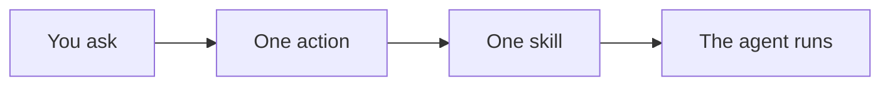

# Skill Router

One skill, before the model runs. The catalog stays off the request.



Eight actions: sense, understand, decide, create, operate, verify, learn, govern. Each maps to one purpose. A risky request stops for a person. The router does not guess.

```bash
node scripts/auto-route.mjs --root . --request "Find the skill that routes installed skills" --pretty
```

Node 18 or newer. No packages to install. MIT.

Built by [@luxurylifestyleco](https://github.com/luxurylifestyleco) at [Vedaxi](https://vedaxi.com).
